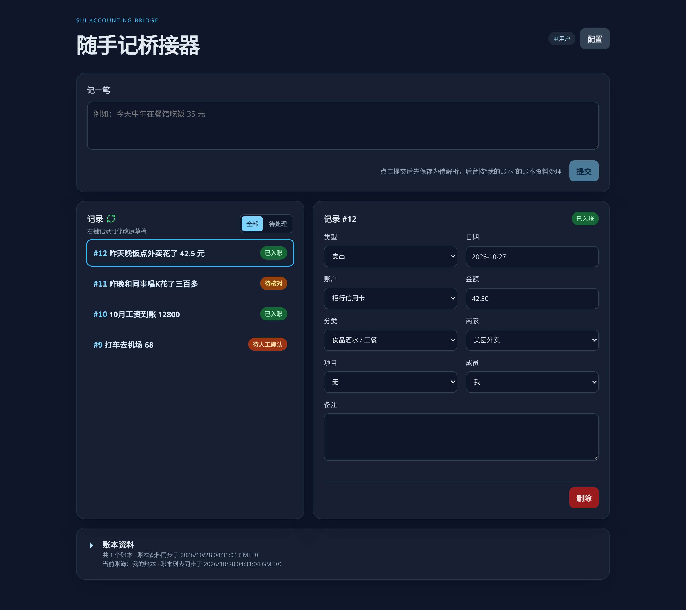

# sui-copilot

**sui-copilot 是随手记的 AI 记账助手。** 账本、分类和报表都还在随手记里，你只需要有一个随手记账号；这个工具负责把「记账」这一步变简单。

在网页或手机快捷指令里说一句「今天午饭 35 元」，AI 会自动填好金额、分类、账户这些随手记要求的字段，直接记进你的账簿。拿不准的记录（比如「花了三百多」）会先停下来等你确认，不会乱记。

> **个人使用项目**：本项目为个人本地使用设计，没有管理员登录和公网防护，**请勿部署到公网**。详见下方[安全边界](#安全边界)。

## 界面预览

电脑端与手机端并排预览，点击图片可查看原图。

<table>
  <tr>
    <td width="73%" valign="top">
      <strong>电脑端</strong>
      <p>录入账目、浏览记录，核对或修改解析结果。</p>
      <a href="docs/screenshots/ui-desktop.png">
        
      </a>
    </td>
    <td width="27%" valign="top">
      <strong>手机端</strong>
      <p>手机浏览器也能直接记账。</p>
      <a href="docs/screenshots/ui-mobile.png">
        
      </a>
    </td>
  </tr>
</table>

<details>
  <summary>查看配置界面：账本、AI 服务商与模型设置</summary>
  <p>
    <a href="docs/screenshots/ui-settings.png">
      
    </a>
  </p>
</details>

## 它能做什么

- **一句话记账**：手机快捷指令或网页里发一句话，后台解析成金额、分类、账户等字段，字段明确的自动写入随手记。
- **拿不准的不乱记**：金额模糊（比如「三百多」）或分类不确定的记录会停下来，等你在网页上确认后再提交。
- **模型服务随便换**：支持 OpenAI、OpenRouter 或其他 OpenAI 兼容的服务，在网页配置里切换，API Key 只写不读。
- **账目都在随手记**：本地只保存草稿和处理状态，最终账目写进你的随手记账簿；本地已入账记录按保留期每天自动清理。
- **电脑手机都能用**：界面自适应屏幕，手机浏览器直接操作。

## 快速开始

### 下载运行

正式版本在 [GitHub Releases](https://github.com/nov12/sui-copilot/releases) 下载，发布包内已嵌入网页，不需要安装 Go 或 Node.js。没有 Release 时，请使用下方的源码构建方式。

| 设备或系统 | 选择的文件后缀 |
| --- | --- |
| Windows | `windows-386.exe`（32 位 x86）、`windows-amd64.exe`（64 位 x86）、`windows-arm64.exe` |
| Linux / x86 软路由 | `linux-386`（32 位 x86）、`linux-amd64`（64 位 x86） |
| ARM 路由器、开发板 | `linux-armv5`、`linux-armv6`、`linux-armv7`、`linux-arm64` |
| 其他 Linux 设备 | `linux-loong64`、`linux-ppc64le`、`linux-riscv64`、`linux-s390x` |
| macOS | `darwin-amd64`（Intel）、`darwin-arm64`（Apple Silicon） |
| FreeBSD | `freebsd-amd64`、`freebsd-arm64` |

文件名均以 `sui-copilot-` 开头。路由器需运行兼容的系统并有足够的内存和可写存储；MIPS/MIPSEL 不受当前数据库依赖支持。ARM 版本选择和安装步骤见[下载与平台说明](docs/development.md#下载与平台)。

### 源码构建

需要安装 [Go](https://go.dev/)、[Node.js](https://nodejs.org/) 和 [Task](https://taskfile.dev/)：

```sh
task setup
task build
```

构建会把网页打包进程序，之后只需要一个可执行文件，不用单独部署前端。

准备配置并登录随手记（把 `<os>-<arch>` 换成实际平台，例如 `linux-amd64`）：

```sh
mkdir -p bin
cp sui-copilot.toml.sample bin/sui-copilot.toml
./bin/sui-copilot-<os>-<arch> auth login --config ./bin/sui-copilot.toml
```

命令会提示输入随手记账号和密码；密码不会保存，登录状态加密存放在数据目录。

启动服务：

```sh
./bin/sui-copilot-<os>-<arch> --config ./bin/sui-copilot.toml
```

然后浏览器打开 `http://127.0.0.1:8080`，就是上面截图里的界面。第一次使用建议先在「配置」里点一次「同步随手记账本列表」和「同步当前账簿分类」，后台解析要用账本的分类资料。

日常配置、手机快捷指令、接口细节见[运行文档](docs/operations.md)。

## 版本

版本号来自 git tag，格式为 `vX.Y.Z`，构建时写入程序：

```sh
./bin/sui-copilot-<os>-<arch> --version
```

推送 `v*` tag 会触发 GitHub Release，待全部平台构建成功后发布二进制、配置示例和 SHA-256 校验文件，并自动生成发布说明。详见[开发与发布](docs/development.md)。

## 文档

- [运行、配置与接口](docs/operations.md)
- [开发与发布](docs/development.md)
- [随手记接口指南](docs/API_GUIDE.md)

## 安全边界

本项目是个人使用项目，不是多用户服务：API 没有管理员登录和 CSRF 层，也没有公网所需的安全加固。请只在个人设备或可信内网运行，服务默认只监听 `127.0.0.1:8080`，请勿把端口直接暴露到公网；如需从其他设备访问，应放在带认证的 HTTPS 反向代理后。真实随手记写入前需要受控验收。

## 生成方式声明

本项目的代码和文档全部由 AI 编程助手（Codex）编写，**未经过人工审核**。虽然经过了自动化测试（Go 测试、前端类型检查与构建），但不保证功能、安全性和随手记接口行为的正确性。使用前请自行审查和验证，尤其是涉及真实随手记账簿写入的功能。

## 目录

```text
cmd/sui-copilot/            sui-copilot 启动入口
internal/accounting/        草稿、解析和校验
internal/httpapi/           API 和静态资源入口
internal/llm/               OpenAI-compatible Chat Completions 客户端
internal/security/          AES-GCM 凭证封装
internal/store/             SQLite 连接、迁移和查询
internal/sui/               随手记 HTTP 适配器
web/                        Vue 3 + TypeScript 前端
```
